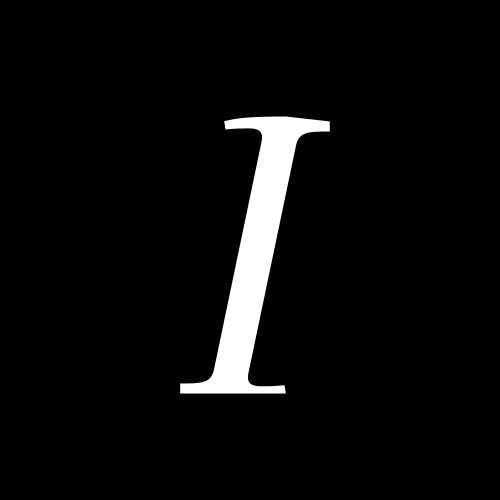

  

<h1 align="center">iota</h1>

  A ray tracer that renders inside the terminal.

  
  
  
  

## Overview

iota casts rays in a terminal, one per cell, and keeps only what a ray hit
and what to do next: shade it, bounce it off a mirror, or let it go into the
fog. The terminal, the cell grid, the ray caster, the frame loop and the
fixed step are the engine's; the scene is the client's.

This repository carries three scenes: a mirror on a wall, a test range with
stairs and crates to walk around in, and a level editor that flies and places
panels. The engine's body is a walking model in
the Quake line — ground friction, air control, a jump and a step it takes
without being asked. More scenes — portals, shadows, water — follow the same
shape.

## Build

    make            build iota and walk
    make walk       build the walking test range
    make edit       build the level editor
    make install    install iota into $(PREFIX)/bin, /usr/local by default
    make clean      remove the build

The build is warning-clean under `-Wall -Wextra -Wpedantic -Wshadow
-Wstrict-prototypes -Wconversion`; CI builds it with every warning fatal.

## Run

    make run

A frame renders within a time budget; while a frame comes back with room to
spend the engine raises the supersampling a ray per cell at a time, up to four,
and when a frame misses the budget it drops a step. Every frame is drawn whole,
so turning never smears the last view over the screen.
The window is any size the terminal gives it, and the status line shows the
millisecond cost, the ray count, the recursion depth and whether the budget
was hit.

`./walk` opens a test range. The body walks, climbs the stairs it can step
onto, is stopped by the wall it cannot, and jumps. The far wall is a mirror,
so the range reflects back along it. A smoothed-particle pool lies in the
way of the walk, thrown into splashes as the body steps through it, and the
body wades slower under the water's drag. `./walk <level>` opens a saved level
instead, and drops the body at its spawn. `Tab` steps to the next `.lvl` in the
working directory or in `levels/`, the body restarting at that map's spawn, and
wraps back to the built-in range after the last one; the current map sits in the
corner of the status line. Two sample maps ship in `levels/`: `bathhouse.lvl`, a
warm tiled bath ringed by pillars and lanterns, its springs pouring steam, and
`castle.lvl`, a small island
joined by a humpback bridge to a Japanese castle whose floors rise from public
baths, through private ones, to a top-floor study.

`./editor [level]` lays out a level. A panel down the left side holds the tools,
the material and the shape settings, drawn with a small immediate-mode widget
set that redraws itself every frame the way Dear ImGui does; a click on the
panel is swallowed there and never reaches the world. The camera flies free and
the pointer moves a cursor whose ray picks the surface under it. A tool shapes
what a pair of clicks builds: a `box` spans two corners in the chosen material,
`wall` raises a straight run to the height the panel sets, `water` floods a
rectangle, `stairs` rise from a foot to a top, `tunnel` bores a roofed,
open-ended corridor, `pit` sinks an open-topped basin of the set depth, `spawn`
sets where the body starts, `light` hangs a lamp, `paint` turns a block's
material over, and `erase` takes a panel away. The `select` tool picks a panel
or a lamp and the panel then edits its position, size, turn and, for a lamp, its
power. The first click drops an anchor, a ghost previews the build as the
pointer moves, and the second click lays it down. A ground grid with coloured
axes can be turned on to line the walls up. `r` turns the block under the cursor
about the vertical. Any number on the panel can be clicked and typed straight
in, landed with Enter. Every change is remembered, so `u` or `Ctrl+Z` steps back
and `Ctrl+Y` steps forward again. The `res` stepper sets how many rays each cell
gathers, from one up to four, or leaves it to the frame budget on auto. `Ctrl+S`
and `Ctrl+O` write and read the level as text.

## Level format

A level is text, one directive per line, `#` comments. `iota 1` heads the
file; `spawn` gives the body's start; `ambient`, `fog` and `sky` carry the
lighting and the sky colours, with an optional moon on the `sky` line (its
direction, colour and size) over a procedural starfield; `water` marks a pool's
rectangle, level and grid
spacing, with any number of `spout` lines giving a spring's mouth above the
water and how hard it pours; `obj` lists a box, sphere, plane or mesh with its
position, half extents, axis, colour, flags, mesh index and a yaw about the
vertical; `light` lists a point or sun light. Colours are six hex digits, flags
are the object's bits.

## Editor controls

| Key | Action |
| --- | --- |
| mouse | move the cursor, click to anchor and to build; the panel takes its own clicks |
| `1` … `9`, `0` | tool: box, wall, water, stairs, tunnel, pit, spawn, light, select, paint |
| `Tab` | cycle to the next tool, including `erase` past the tenth |
| `m` | block material: wall, tile, mirror |
| `r` | turn the block under the cursor an eighth of a turn |
| click a number | type the value in, Enter lands it, Escape drops it |
| right click | cancel the anchor, or take the panel under the cursor |
| `W` `A` `S` `D` | fly along the view |
| `space` / `c` | rise and sink |
| arrow keys | look |
| `g` | toggle grid snapping |
| `h` | show the key list |
| `p` | set the spawn at the cursor |
| `u` / `Ctrl+Z` | undo, `Ctrl+Y` redo |
| `n` | new, `Ctrl+S` save, `Ctrl+O` load |
| `Esc` | cancel the anchor, or quit |

The panel carries the tool and material buttons, steppers for the stair riser,
stair width, wall thickness and height, the pit depth, the new lamp's power and
the render resolution, toggles for the snapping and the ground grid, and the
properties of whatever the `select` tool last picked. A stepper's number opens an
edit when clicked, so an exact value can be typed rather than nudged.

## Controls

| Key | Action |
| --- | --- |
| `W` `A` `S` `D` | move |
| arrow keys | look |
| `space` | jump, in `walk` |
| `Esc` | quit |

## The renderer

One ray per cell at the base sample, nearest hit kept, so thin geometry
survives and objects occlude the floor and each other. A surface is shaded
by the scene's lights — ambient plus every point and sun light that sees
it — and fog takes over with distance. A ray that meets nothing gets the sky:
a top-to-horizon gradient, a field of stars, and the moon the scene hangs.

A hit carries an action. A plain surface is shaded and done; a mirror
reflects the ray about the surface normal and traces again, up to two
bounces deep. A frame that overruns the budget says `BUDGET` on the status
line, and the engine lowers the sample count for the next frame rather than
stopping the ray early.

Triangles are another surface. An OBJ loader reads them into a bounding
volume hierarchy, and a ray casts against the ones it crosses, so a model
files through a scene the way a box does.

Water is a cloud of particles in a smoothed-particle pool: each one sums its
neighbours' density, feels the pressure and drag that density gives, falls
under gravity and bounces off the trough. The body shoves the drops aside,
its motion casts them up in a splash, and the view walks a ray through the
pool, shading the first place the density turns to water: the surface shows
the ripples and the splash throws up a spray.

## Layout

    include/    the engine's headers
    src/        the engine
    demos/      the scenes
    assets/     the mark and a sample mesh

## Version

iota follows [Semantic Versioning](https://semver.org). The current release is
`0.1.0`, kept in `include/engine.h` as `IOTA_VERSION`; every release is a tag
and a note in [CHANGELOG.md](CHANGELOG.md). See [CONTRIBUTING.md](CONTRIBUTING.md)
to help.

## License

MIT. See [LICENSE](LICENSE).
